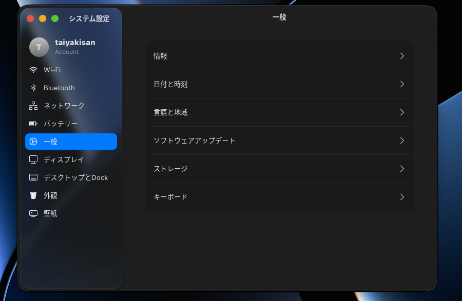

# 記入 使用してたテーマに設定アプリが来ちゃった（（泣））
[🇬🇧English](README.md)
# mac-kde-settings
これはmac osのような外観を持つGTK4ベースのKDE設定画面です\
このアプリはGTK4とpythonでできており、\
mac osのUIをオマージュしたアプリケーションです。
# 画像
\
(自分は [macos-tahoe-liquid-kde](https://github.com/lestercorderomurillo/macos-tahoe-liquid-kde) テーマを使用しています。)

# インストール＆アンインストール
依存パッケージ\
pacman
```bash
sudo pacman -S python-gobject gtk4 libadwaita
```
apt
```bash
sudo apt install python3-gi gir1.2-gtk-4.0 gir1.2-adw-1
```
dnf
```bash
sudo dnf install python3-gobject gtk4 libadwaita
```
インストール方法
```bash
git clone https://github.com/takosu12342025/mac-kde-settings
cd mac-kde-settings
bash install.sh
```
アンインストール方法
```bash
cd mac-kde-settings
bash uninstall.sh
```


# 依存関係
必須のランタイム・UIライブラリ（これがないと起動しない）\

• Python 3 (python / python3)\
• PyGObject (python-gobject / python3-gi) — PythonからGTKを動かすブリッジ\
• GTK 4 (gtk4 / libgtk-4-1)\
• Libadwaita (libadwaita / libadwaita-1-0) — macOS風のサイドバーや角丸カード、ダイアログを描画するライブラリ
# 注意
このアプリはAIを使用して作られています

