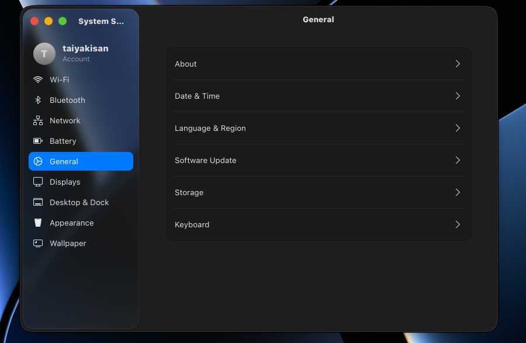

[🇯🇵日本語](README.jp.md)
# mac-kde-settings
This is a GTK4-based KDE configuration with a macOS-like look.\
This application is built using GTK4 and Python, and it replicates the user interface (UI) style of macOS.\

# images

(I am using the [macos-tahoe-liquid-kde](https://github.com/lestercorderomurillo/macos-tahoe-liquid-kde) theme.)
# Dependencies
Required runtime and UI libraries (the application will not launch without these):\

• Python 3 (python / python3)\
• PyGObject (python-gobject / python3-gi) — A bridge for using GTK with Python\
• GTK 4 (gtk4 / libgtk-4-1)\
• Libadwaita (libadwaita / libadwaita-1-0) — A library used for rendering macOS-style elements, such as sidebars, rounded-corner cards, and dialogs
