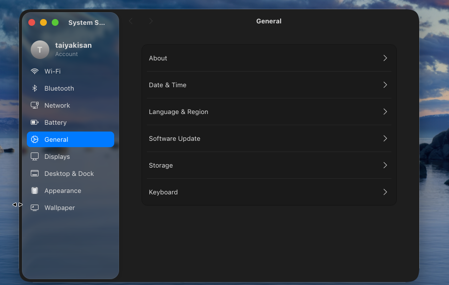
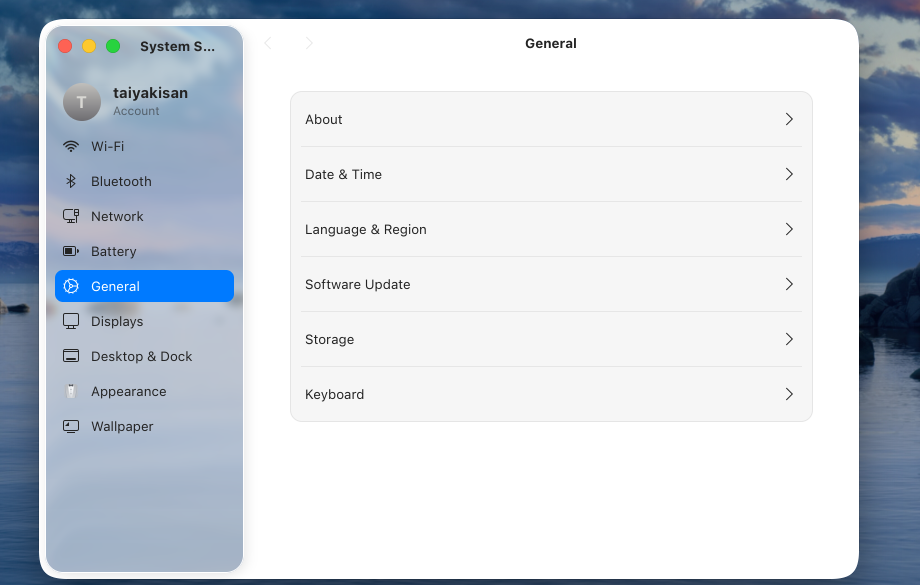

[🇯🇵日本語](README.jp.md)
# mac-kde-settings
This is a KDE configuration based on GTK4 that features a macOS-like appearance. The application is built using GTK4 and Python,\ and it pays homage to the macOS user interface (UI) style.
# images



(I am using the [macos-tahoe-liquid-kde](https://github.com/lestercorderomurillo/macos-tahoe-liquid-kde) theme.)

Dependencies

Installation
```bash
git clone https://github.com/takosu12342025/mac-kde-settings
cd mac-kde-settings
bash install.sh
```

# Dependencies
Required runtime and UI libraries (the application will not launch without these):\

• Python 3 (python / python3)\
• PyGObject (python-gobject / python3-gi) — A bridge for using GTK with Python\
• GTK 4 (gtk4 / libgtk-4-1)\
• Libadwaita (libadwaita / libadwaita-1-0) — A library used for rendering macOS-style elements, such as sidebars, rounded-corner cards, and dialogs
# Note
This app was created using AI.\
It was translated using Google Translate.\
